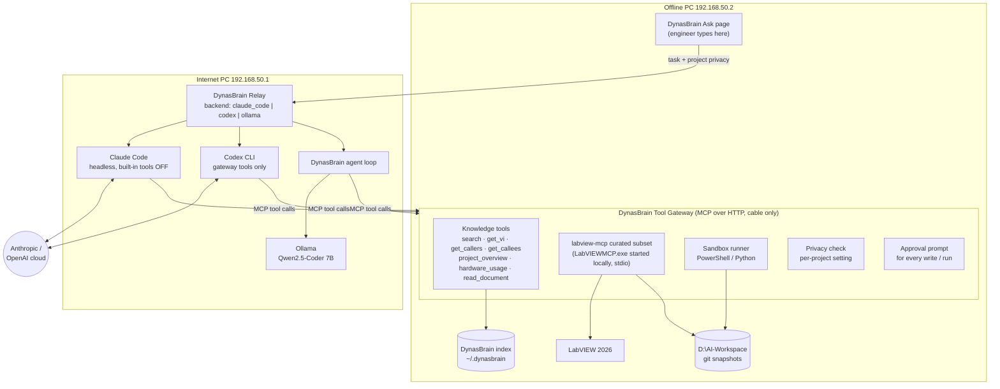
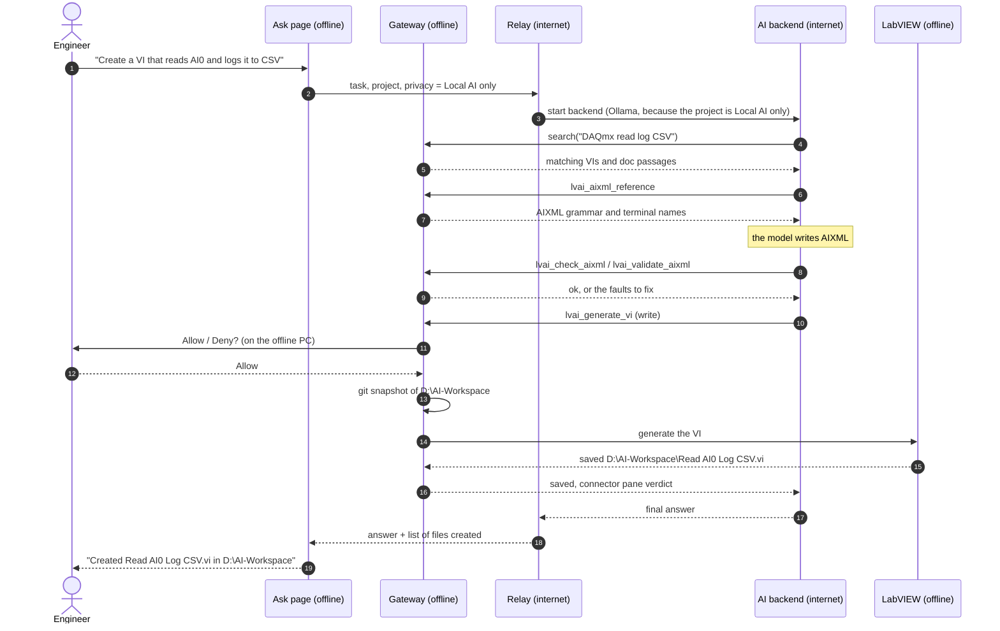

# 2. Architecture

## The two PCs

Two Windows 10 Pro PCs, joined by a **direct Ethernet cable** (no switch, no Wi-Fi).

| | Internet PC | Offline PC |
|---|---|---|
| Cable IP (proposed) | `192.168.50.1` | `192.168.50.2` |
| Internet access | yes | **no** |
| LabVIEW, Python | yes | yes |
| DynasBrain, ai-chatbot | yes | yes |
| Claude Code / Codex CLI | yes | **no** |
| Local AI (Ollama) | yes, 7B | optional, 3B |
| RAM | 16 GB (laptop) | 16 GB, 8–9 GB already in use |
| **Role** | **Brain**: runs the AI, talks to the internet | **Hands**: files, LabVIEW, PowerShell, Python |
| VIs created and run here | **never** | **only here** |

## Components

### Offline PC: DynasBrain Tool Gateway (to build)

- DynasBrain already serves MCP over HTTP at `/mcp` (9 read-only tools). The gateway
  extends that server so it can be reached **over the cable only**, with an access key.
- It starts **labview-mcp** (`LabVIEWMCP.exe`) locally over stdio and re-offers a
  **curated subset** of its tools (below). This also solves the fact that labview-mcp
  speaks only stdio and cannot be reached across the network by itself.
- It adds a **sandbox runner** for PowerShell and Python scripts ([Sandbox](04-sandbox.md)).
- It checks every tool result against the project's **privacy setting** ([Privacy](03-privacy.md)).
- Every write or run tool is marked `destructiveHint` and needs **approval on the offline PC**.

### Internet PC: DynasBrain Relay (to build)

- Receives a task from the offline PC's Ask page.
- Starts the chosen backend:
  - **Claude Code:** `claude -p` headless, as DynasBrain's `ask.py` already does. Every built-in tool is off (no shell, no file access), only the gateway's MCP tools are allowed, and the question goes in over stdin.
  - **Codex CLI:** the same principle, with gateway tools only.
  - **Local AI:** a DynasBrain agent loop that calls Ollama through the OpenAI-compatible API and uses the same gateway tools.
- Streams progress back ("searching…", "generating VI…", "waiting for approval…") and supports **cancel**.
- Uses the setting `AI_BACKEND = claude_code | codex | ollama | openai_compatible`, already planned in DynasBrain's PLAN.md Phase 2.

### ai-chatbot

- General chat on both PCs. It can also add the gateway as an MCP tool source (Settings → Tools).
- **Needed change:** its `docs/HANDOVER.md` §2A ("Claude Code / Codex sharing") runs the agent in a
  **folder on the internet PC**. Under this design the agent must run with **no local file
  access** and the **offline gateway's tools only**, so files are never created on the
  internet PC.
- Its home server is also an OpenAI-compatible model server, so it can stand in for Ollama.

## One request, end to end

## Curated labview-mcp tool set

labview-mcp offers 114 tools, far too many for a small local model. Start with this
set and grow it only when the [test set](07-training.md#1-answer-quality-test-set) shows a need.

| Group | Tools | Needs LabVIEW running | Kind |
|---|---|---|---|
| Status | `lvai_status`, `pylv_status` | lvai: yes | read |
| Read / understand | `lvai_describe_vi`, `lvai_describe_project`, `lvai_convert_vi_to_aixml`, `pylv_extract`, `pylv_route` | lvai: yes, pylv: no | read |
| Reference lookups | `lvai_aixml_reference`, `lvai_search_info_cache`, `lvai_palette_index`, `lvai_example_index` | partly no | read |
| Create | `lvai_check_aixml`, `lvai_validate_aixml`, `lvai_generate_vi` | yes | **write** |
| Run | `lvai_run_vi_and_read_values` | yes | **write** |

- **Never** expose `lvai_apply_aixml_to_vi`. It fails with Error 42; see labview-mcp
  `docs/guide/safety.md`.
- Claude Code and Codex may get a larger set than the local model.
- `lvai_*` tools need **LabVIEW 2026 Q3** running on the offline PC. With LabVIEW 2020
  only `pylv_*` and DynasBrain's own reader work.
- Generated VIs lose layout, decorations and icon if regenerated. labview-mcp measured that only
  ~15% of production VIs can be regenerated via AIXML. So **new small VIs** are the
  target, not rewriting existing ones.

## Where data lives

| Data | Location | Leaves the offline PC? |
|---|---|---|
| Project VIs and documents | Offline PC project folders | Only as tool results, and only if the privacy setting allows |
| DynasBrain index | Offline PC `~/.dynasbrain` | Same as above |
| AI-created VIs and scripts | Offline PC `D:\AI-Workspace\` | No |
| Prompts and answers, local AI | Internet PC memory, LAN only | No (stays on the cable) |
| Prompts and answers, Claude / Codex | Anthropic / OpenAI | **Yes**, so only for projects that allow it |
| Training data | This repository / Colab | Public data only |
