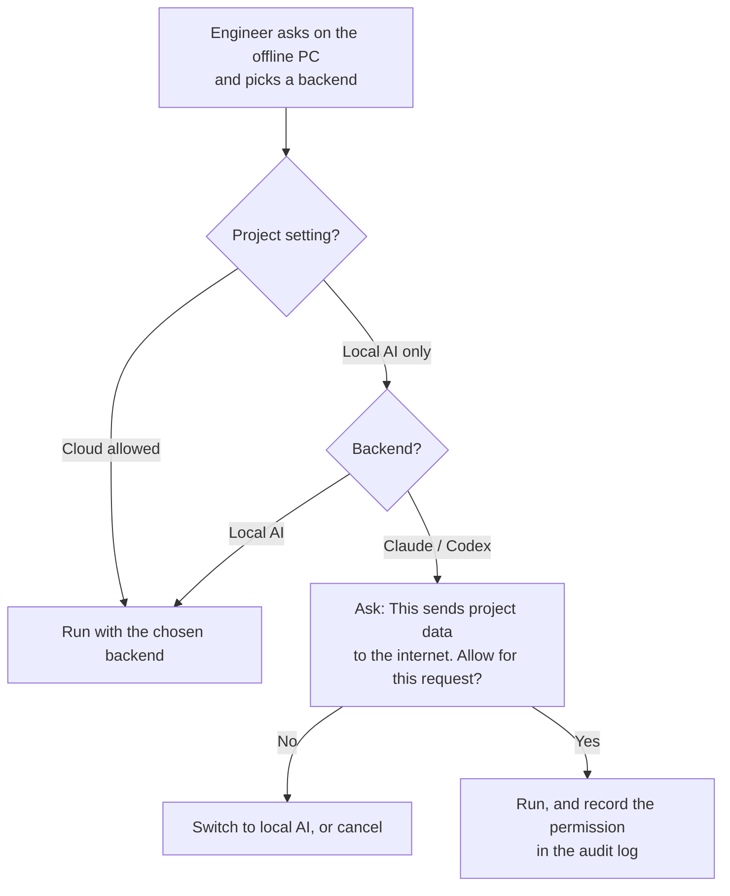

# 3. Privacy rules

## The rule

Every DynasBrain project has one setting:

| Setting | Meaning |
|---|---|
| **Local AI only** | Data from this project may only be seen by the local model (Ollama on the internet PC, reached over the cable). It never reaches a cloud service. |
| **Cloud allowed** | Claude Code and Codex may also be used. Data seen by the AI is sent to Anthropic or OpenAI. |

**Default for now: every project is "Local AI only".** The company's confidentiality
policy will be decided later. The setting exists from day one, so deciding later needs no
redesign.

## What "data" means

With Claude or Codex, everything the AI sees goes to the cloud:
- the question;
- every tool result: VI names, descriptions, diagram text, connector panes, document passages, file contents;
- the AI's own drafts, such as AIXML.

So privacy has to be enforced on **tool results**, not only on the question.

## How it is enforced

1. **The offline PC enforces it, not the internet PC.** The gateway knows which session is
   cloud-backed and refuses to return a "Local AI only" project's data to it, unless the
   engineer allowed that request on the offline PC. A mistake or a bug on the internet PC
   cannot leak data on its own.
2. **Per-request permission** applies only to that request, never to the whole session.
3. **Audit log** on the offline PC: time, backend, project, tools called, and whether
   cloud permission was given.

## Training data

- Fine-tuning on Google Colab uses **public data only**: NI documentation, labview-mcp
  docs, generic LabVIEW examples.
- **Our own Q&A** is added only after a person removes customer names, project details,
  limits, IP addresses and part numbers.
- Confidential projects stay in DynasBrain's local index. The model uses them through
  search at question time and never learns them through training.

## The cable link

The offline PC accepts commands from a PC that is on the internet. That partly opens its
isolation. The mitigations are in [Network setup](05-network-setup.md):
- cable-only listener;
- firewall locked to the internet PC's IP;
- access key;
- approvals on the offline PC.

**IT approval is required before use.**
