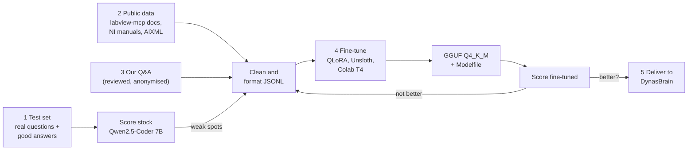

# 7. Training (this repository)

This repository produces the fine-tuned model. DynasBrain only needs the model's name to
switch to it.

## What fine-tuning is for

| Comes from fine-tuning | Comes from DynasBrain search at question time |
|---|---|
| AIXML syntax and LabVIEW terminal names | Our projects, VIs and documents |
| Tool-call format (which tool, which arguments) | NI manual passages |
| LabVIEW vocabulary and answer style | Anything confidential |

Fine-tuning a 7B model on a few thousand examples teaches **format and style** reliably,
but not facts. Facts come from search, so they stay current and confidential data is never
trained into the model.

**Rule:** train only after the stock model has been measured. The fine-tuned model replaces
it only if it scores higher on the test set.

## Pipeline



### 1. Answer-quality test set

Build this **first**.
- 30–100 real questions with known good answers, in a CSV: `question`, `category`
  (`labview`, `daqmx`, `xnet`, `modbus`, `aixml`, `tool-use`, ...), `expected` (key facts
  or the expected tool calls), `public` (yes/no).
- Questions marked `public = no` are run only on our own PCs, never on Colab.
- Scoring: an engineer marks each answer correct / partly / wrong. Tool-use questions are
  checked automatically (right tool, valid AIXML).
- DynasBrain's `dynasbrain eval` measures **search** quality (hit@5). This set measures
  **answer** quality. Both are needed.

### 2. Public data

| Source | What to take |
|---|---|
| labview-mcp `docs/` | `aixml-reference.md`, `error-list.md`, the `cold-build-*` post-mortems, `dqmh-patterns.md` |
| labview-mcp `.claude/agents/` | Agent definitions: how a VI is generated or edited, step by step |
| labview-mcp tool descriptions | Tool names and arguments, for tool-call examples |
| AIXML examples | Converted NI shipping examples (`lvai_convert_vi_to_aixml`) |
| NI manuals | DAQmx, NI-XNET, LabVIEW help (PDF), checking NI's terms of use |

Check the licences: labview-mcp's own licence for its docs, and NI's terms for its
documentation.

### 3. Our own Q&A

- Claude Code chat history about LabVIEW, exported.
- Questions from DynasBrain's feedback log, where an engineer marked an answer as bad.
- **A person removes** customer names, project names, limits, IPs and part numbers before
  anything is added.

### 4. Fine-tuning

| Item | Value |
|---|---|
| Method | QLoRA via Unsloth |
| Where | Google Colab, free T4 GPU (public data only) |
| Base | Qwen2.5-Coder-7B-Instruct (3B optional) |
| Time | ~1–3 hours for 7B |
| Output | `labview-assistant-Q4_K_M.gguf` + `Modelfile` |

If confidential examples are ever needed, they can only be trained on a GPU PC inside the
company, never on Colab.

### 5. Delivery

A release in this repository with the GGUF file, the `Modelfile` and the test-set score
next to the stock model's score. Install steps: [Local model](06-local-model.md#offline-installation).

## Planned repository layout

```
labview-ai-training-/
├─ docs/                    this documentation
├─ eval/                    test set CSV + scoring script
├─ data/
│  ├─ public/               generated from labview-mcp docs etc. (not committed if large)
│  └─ reviewed/             anonymised own Q&A
├─ scripts/
│  ├─ extract_training_data.py
│  └─ convert_chats.py
└─ notebooks/
   └─ colab_finetune.ipynb
```

The earlier scripts (`extract_training_data.py`, `convert_chats.py`,
`colab_finetune.ipynb`) are not in the repository yet. Add them when available.
