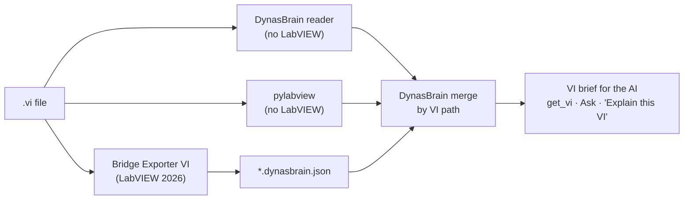

# 8. Understanding VI logic

A `.vi` file is binary. No AI model, local or cloud, can read it directly. To explain a
VI's logic, the VI is first turned into **text**. There are three sources, and DynasBrain
merges them by VI path.

| Source | What it gives | Needs LabVIEW? | LabVIEW versions | Status |
|---|---|---|---|---|
| **DynasBrain file reader** | Description, LabVIEW version, every subVI/typedef/class link, connector pane (inputs, outputs, types, required), front panel labels, diagram comments and string constants, icon | no | tested on 2020 | **built** |
| **pylabview** (`pylv_extract`, bundled with labview-mcp) | Diagram objects read from the file: nodes, structures and their contents | no | 2020 and 2026 | exists in labview-mcp; merging into DynasBrain is to build |
| **Bridge Exporter VI** | LabVIEW's own view: `broken` verdict, structures with case/event names, nodes, property/invoke nodes, typed constants, **wires** (data flow) | **yes**, LabVIEW 2026 | 2026 | contract, merge and `bridge-check` built; the VI itself must be built in LabVIEW |

## Why both pylabview and the bridge

- **pylabview** works on any PC with no LabVIEW, including LabVIEW 2020 code and closed
  projects. It reads what is in the file.
- **The bridge** asks LabVIEW itself, so it is authoritative: it knows whether a VI is
  broken, the real case names and how wires connect. It needs LabVIEW 2026 and has to be
  run when code changes.
- Merged, the AI gets structure and data flow wherever possible, with a clear note of which
  source each fact came from.

## Bridge Exporter VI

The contract, schema, example and a step-by-step build guide are in DynasBrain:
[`labview/bridge/README.md`](https://github.com/Robokks/labview-ai-assist/blob/claude/session-01m7yheq4w4qbrn2qolmx9zw-tgkzkx/labview/bridge/README.md).
In short:

1. Enable VI Scripting in LabVIEW 2026 (Tools » Options » VI Server).
2. For each VI in the project: open a reference, read `Execution:State` (broken), then
   traverse the diagram for SubVI, Function, Structure, Constant, Property Node,
   Invoke Node and Wire objects.
3. Write one `<VI name>.dynasbrain.json` per VI into `<project>\.dynasbrain\`.
4. Check the output with `dynasbrain bridge-check "<project>\.dynasbrain"`.
5. **Rebuild** the project in DynasBrain.

This VI must be built by a person in LabVIEW (about 1–2 hours for someone used to VI
Scripting). It cannot be generated from the repository.

## Limits

- **Password-protected** diagrams are respected: no diagram text is read or exported.
- **Very large VIs** have to be explained in parts, because of the model's context size.
- The local 7B model explains small and medium VIs well. Large state machines are better
  explained one case at a time.
