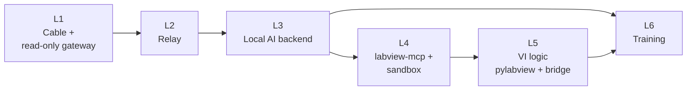

# 9. Milestones

Each milestone ends with something that can be tried on the two PCs.

| # | Milestone | Repo | Done when |
|---|---|---|---|
| **L1** | Cable link + read-only gateway | DynasBrain | Fixed IPs and firewall set ([Network setup](05-network-setup.md)). Claude Code on the internet PC answers a question using the offline PC's DynasBrain tools over the cable. Then the gateway adds an access key and serves only the MCP endpoint on the cable. |
| **L2** | Relay | DynasBrain | A question typed on the offline PC's Ask page is answered by Claude Code or Codex on the internet PC, with progress and cancel. Privacy setting enforced on the offline PC, with an audit log. |
| **L3** | Local AI backend | DynasBrain | Stock Qwen2.5-Coder 7B via Ollama answers through the same relay and tools. The first test-set score is recorded. |
| **L4** | labview-mcp + sandbox | DynasBrain | The gateway starts labview-mcp and offers the curated tools. A small VI is generated and run in `D:\AI-Workspace\` with approval and a git snapshot. PowerShell/Python runner as the limited user. |
| **L5** | VI logic | DynasBrain + LabVIEW | pylabview data merged into DynasBrain. The bridge Exporter VI built and its output merged. "Explain this VI" gives sequence and data flow. |
| **L6** | Training | this repo | Test set, public dataset, fine-tuned 7B GGUF. Swapped in only if it beats the stock model. |
| Later | | | QA / code review; MCP Server Toolkit for test rigs; multi-user tokens; LabVIEW WebView2 panel |

## Also to do

- **ai-chatbot:** revise HANDOVER §2A so shared Claude Code / Codex use only the offline
  gateway's tools, not a folder on the internet PC.
- **Training repo:** add the earlier scripts (`extract_training_data.py`, `convert_chats.py`,
  `colab_finetune.ipynb`).

## Open questions

| # | Question | Default until decided |
|---|---|---|
| 1 | Offline PC UI: DynasBrain Ask for LabVIEW work and ai-chatbot for general chat, or ai-chatbot for everything? | DynasBrain Ask for LabVIEW |
| 2 | Confidentiality policy: which projects may go to Claude/Codex? | None ("Local AI only") |
| 3 | IT approval for the cable link | Required before L1 on real projects |
| 4 | LabVIEW version on each PC (`lvai_*` needs 2026 Q3) | Assume 2026 Q3 on the offline PC |
| 5 | Claude Code sign-in on the internet PC | Subscription login, no API key |
| 6 | CPU model of each PC, for better speed estimates | — |
