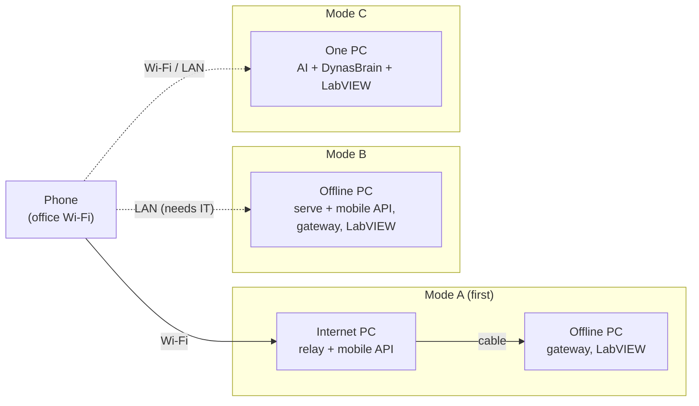
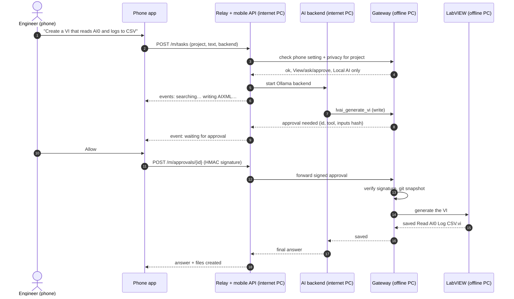

# 11. Mobile remote

Use DynasBrain from a **phone on the same network**: ask questions, send commands
("generate a VI that…", "run this script"), watch progress, see results and approve
actions. The phone is only a **remote control**. Thinking still happens on the internet
PC and every VI is still **generated and run on the offline PC**.

Status (2026-11-01): design agreed, not built.

## Decisions

| Question | Decision |
|---|---|
| Which PC does the phone talk to? | All three, built in this order: **A** internet PC → **B** offline PC directly → **C** single PC |
| Can the phone approve writes/runs? | **Per-project setting** (below) |
| What is the app? | **Web app (PWA) first**, then a native screen in the **ai-chatbot** Flutter app. Both use the same API |
| Order of work | This design first, then build in DynasBrain |

## What the phone can do

| Screen | What it does |
|---|---|
| **Pair** | Scan the QR code shown by DynasBrain on the PC (or type the PIN). Done once per phone |
| **Status** | Internet PC, offline PC, gateway, relay, LabVIEW, AI backend: up or down |
| **Projects** | List of DynasBrain projects with their privacy and phone setting |
| **Ask** | Chat: type a question or command, pick backend (local AI / Claude / Codex), see live progress ("searching…", "generating VI…", "waiting for approval…"), **Cancel** |
| **Approvals** | Pending Allow / Deny requests with the tool name and its inputs, if the project allows phone approval |
| **Files** | Files the AI created in `D:\AI-Workspace\`, their description and connector pane, snapshots, **Revert** |
| **History** | Earlier questions and answers |

The phone never receives or runs a VI. It sees text: answers, descriptions, file lists.

## The three connection modes



| Mode | Phone connects to | Generation happens on | Keeps the offline PC isolated? | Notes |
|---|---|---|---|---|
| **A** | Internet PC (its Wi-Fi/LAN IP), port `8767` | Offline PC, through the cable | **Yes** | Recommended. Works with the L1/L2 setup already built |
| **B** | Offline PC (a second network adapter) | Offline PC | **No**: the offline PC joins the office network | Needs **IT approval**. Still no internet route on that adapter |
| **C** | The one PC | That PC | Not applicable | For home/test setups and for people with one PC |

The phone API is **the same in all three modes**, so the PWA and the Flutter app do not
care which mode is used. Only the address changes.

## Phone setting per project

Next to the privacy setting ([Privacy](03-privacy.md)) every project gets a **phone setting**:

| Setting | Phone may | Default for |
|---|---|---|
| **Off** | nothing for this project; it is hidden on the phone | — |
| **View and ask** | see answers, ask, send commands, cancel. **Approvals stay on the offline PC** | **every project (default)** |
| **View, ask and approve** | the above, plus Allow / Deny on the phone | test projects you choose |

```powershell
dynasbrain phone test-project --approve     # View, ask and approve
dynasbrain phone customer-x --view          # View and ask (default)
dynasbrain phone customer-x --off           # hidden from the phone
```

The setting is stored and enforced on the **offline PC** (in mode C, the one PC), like the
privacy setting. Cloud permission ("Allow sending this project's data to the cloud AI")
can be given from the phone only for projects set to *View, ask and approve*.

## Security

### Pairing

1. On the PC that owns the settings (offline PC in modes A/B, the one PC in mode C):
   `dynasbrain phone-pair`. It shows a **QR code** and a **6-digit PIN**, valid 5 minutes.
2. The phone scans it (or types the PIN). It receives a **phone key**: a random secret
   stored only on that phone and on the offline PC.
3. `dynasbrain phone-list` shows paired phones, `dynasbrain phone-unpair <name>` removes one.

In mode A the QR is shown on the offline PC, but the phone talks to the internet PC. The
pairing code is passed through the relay; the phone key itself is created from the QR
contents, so the internet PC never learns it.

### Approvals cannot be faked by the internet PC

In mode A an approval travels phone → internet PC → cable → offline PC. A bug or an attacker
on the internet PC must not be able to approve on its own. So:

- every approval request from the gateway carries an id, the tool name and a hash of its inputs;
- the phone **signs** "allow / deny + id + hash" with its phone key (HMAC-SHA256);
- the **offline PC checks the signature** and that the project allows phone approval;
- a missing or wrong signature means Deny. No answer in 2 minutes means Deny, as on the PC.

The audit log (`%USERPROFILE%\.dynasbrain\audit.jsonl`) records `approved_by: phone:<name>`
or `approved_by: pc`.

### Network

- The mobile API listens on its own port (`8767`) on the Wi-Fi/LAN adapter, **not** on the cable.
- Firewall: allow `8767` only from the office Wi-Fi subnet (ask IT for it), better from the
  phone's reserved IP.
- Every call needs the phone's session token, valid 12 hours; re-unlocked with the phone key.
- **TLS**: DynasBrain creates a self-signed certificate; its fingerprint is in the pairing QR,
  so the Flutter app pins it. The browser shows a warning once for the PWA.
- Some office Wi-Fi networks block phone-to-PC traffic ("client isolation"). If the phone cannot
  reach the PC, ask IT, or use a PC on wired LAN with the phone on the same VLAN.

### What lands on the phone

Answers and tool summaries for projects set to *View and ask* or higher are shown on the
phone. Nothing is cached on the phone after logout, and projects set to **Off** never appear.

## Phone API

Served by the relay (mode A) or by `dynasbrain serve` (modes B and C), under `/m/`.

| Method | Path | Purpose |
|---|---|---|
| `POST` | `/m/pair` | Exchange pairing code for a phone id |
| `POST` | `/m/session` | Phone key proof → session token |
| `GET` | `/m/status` | Health of PCs, gateway, relay, LabVIEW, backends |
| `GET` | `/m/projects` | Projects with privacy and phone setting |
| `POST` | `/m/tasks` | Start a question/command: project, text, backend, cloud permission |
| `GET` | `/m/tasks/{id}/events` | Live progress (Server-Sent Events) |
| `POST` | `/m/tasks/{id}/cancel` | Cancel |
| `GET` | `/m/approvals` | Pending approvals the phone may answer |
| `POST` | `/m/approvals/{id}` | Signed Allow / Deny |
| `GET` | `/m/files` | Workspace files, snapshots |
| `POST` | `/m/files/revert` | Revert to a snapshot (an approval-type action) |
| `GET` | `/m/history` | Earlier tasks |

## One command from the phone (mode A)



If the project is only *View and ask*, step 11 is replaced by the Allow/Deny prompt on the
offline PC screen, and the phone shows "waiting for approval on the offline PC".

## Build plan

| # | Step | Repo | Done when |
|---|---|---|---|
| **P1** | Phone API + PWA, mode A, view and ask | DynasBrain | Phone on Wi-Fi pairs, asks a question, sees progress, cancels. Approvals on the offline PC |
| **P2** | Phone approvals | DynasBrain | Per-project phone setting; signed approvals from the phone verified on the offline PC; audit log shows `phone:<name>` |
| **P3** | Files and history screens | DynasBrain | Created files, snapshots and Revert visible from the phone |
| **P4** | Mode B (offline PC directly) | DynasBrain | Same PWA works against `dynasbrain serve` on the offline PC's LAN adapter. After IT approval |
| **P5** | Mode C (single PC) | DynasBrain | One PC runs backend + gateway + mobile API; phone works unchanged |
| **P6** | ai-chatbot Flutter screen | ai-chatbot | "DynasBrain remote" screen using the same API, QR pairing, pinned TLS, a notification for pending approvals while the app is open |

P1 needs L2 (relay). Generating VIs from the phone needs L4 (labview-mcp + sandbox); until
then the phone can ask questions and explain VIs.

## Network setup for mode A

On the **internet PC**, administrator PowerShell:

```powershell
Get-NetIPAddress -AddressFamily IPv4 | Format-Table InterfaceAlias, IPAddress   # note the Wi-Fi IP
$wifi = "Wi-Fi"                                    # your Wi-Fi/LAN adapter name
$subnet = "10.0.0.0/24"                            # office Wi-Fi subnet, from IT
New-NetFirewallRule -DisplayName "DynasBrain mobile (Wi-Fi)" `
  -Direction Inbound -Action Allow -Protocol TCP -LocalPort 8767 `
  -RemoteAddress $subnet -InterfaceAlias $wifi -Profile Private,Domain
dynasbrain relay --host 192.168.50.1 --gateway http://192.168.50.2:8765 `
  --mobile-host <wifi-ip>                          # mobile API on <wifi-ip>:8767
```

On the **offline PC**: `dynasbrain phone-pair`, scan the QR with the phone, then open
`https://<wifi-ip>:8767/m/` on the phone and choose **Add to Home screen**.

Ask IT for a **DHCP reservation** for the internet PC so its Wi-Fi IP does not change.

To remove: `Remove-NetFirewallRule -DisplayName "DynasBrain mobile (Wi-Fi)"`.

## Open questions

| # | Question | Default until decided |
|---|---|---|
| 1 | Office Wi-Fi subnet, and whether client isolation is on | Ask IT before P1 |
| 2 | Should phone approval ever be allowed for "Local AI only" projects? | Allowed only if the project's phone setting is *View, ask and approve* |
| 3 | Push notifications when the app is closed (would need a cloud push service) | Not used; notifications only while the app is open |
| 4 | Several phones / several engineers | One engineer, several phones allowed |
