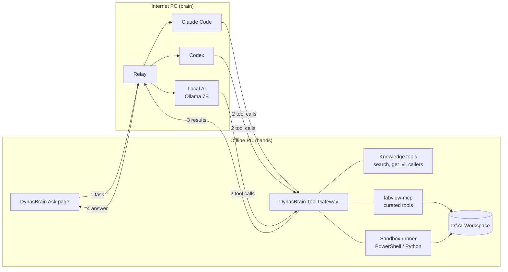

# LabVIEW Local AI: Documentation

Documentation for Dynaspede's LabVIEW AI assistant. The AI understands our LabVIEW
work, answers questions, explains VI logic and creates small VIs, while confidential code
stays on our own machines.

**Status (2026-10-31):** design agreed. Nothing in this design is built yet, except what
already exists in DynasBrain and labview-mcp.

## Read in this order

| # | Document | What it answers |
|---|---|---|
| 1 | [Overview](01-overview.md) | What we are building, for whom, and which repositories are involved |
| 2 | [Architecture](02-architecture.md) | The two PCs, the gateway and the relay, and how one request flows |
| 3 | [Privacy rules](03-privacy.md) | What may leave the company, and how that is enforced |
| 4 | [Sandbox](04-sandbox.md) | How the offline PC is protected when the AI creates and runs code |
| 5 | [Network setup](05-network-setup.md) | Step by step: cable, fixed IPs, firewall, first test |
| 6 | [Local model](06-local-model.md) | Which model, RAM, speed, and offline installation |
| 7 | [Training](07-training.md) | Test set, datasets, fine-tuning and delivery (this repository) |
| 8 | [Understanding VI logic](08-vi-understanding.md) | How the AI "reads" a binary VI: DynasBrain reader, pylabview, bridge Exporter VI |
| 9 | [Milestones](09-milestones.md) | Build order, done-criteria and open questions |
| 10 | [Glossary](10-glossary.md) | Terms used in these documents |
| 11 | [Mobile remote](11-mobile-remote.md) | Use DynasBrain from a phone on the same network; generation stays on the PC |

Short versions: [../PLAN.md](../PLAN.md) (one-page plan) and
[../CONTEXT.md](../CONTEXT.md) (summary for starting a new AI session).

## The design in one picture

The AI **thinks** on the internet PC. Everything it **does** happens on the offline PC.
